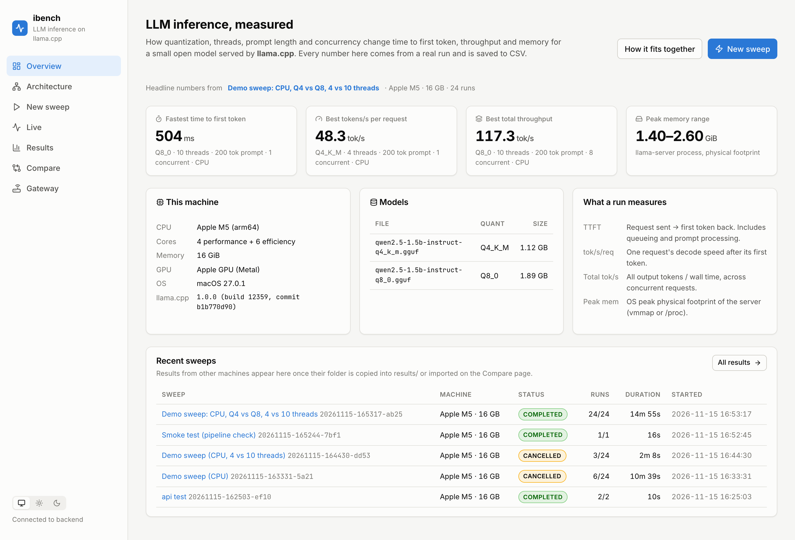
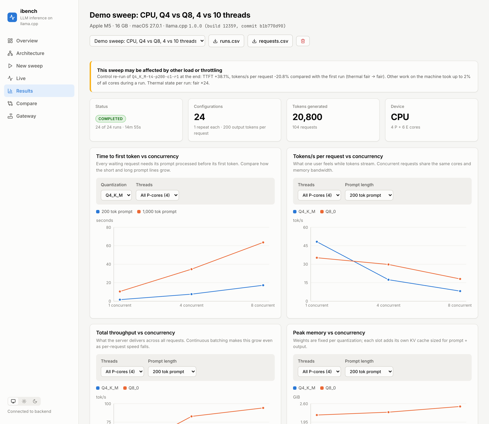
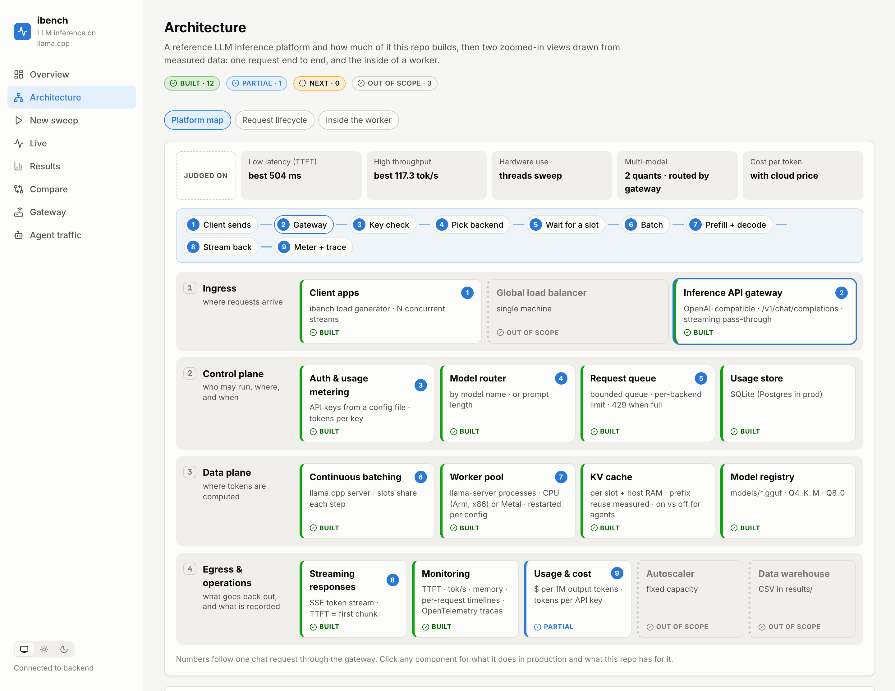
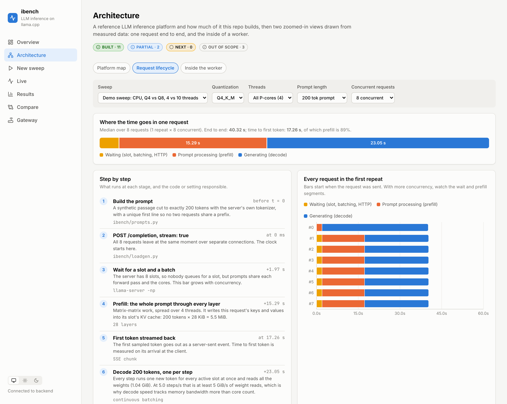
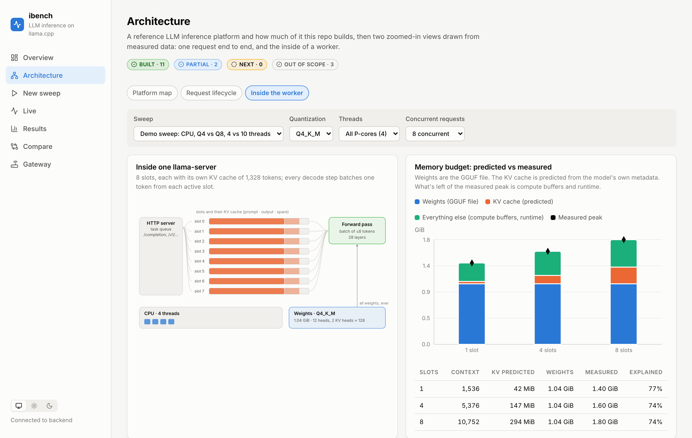
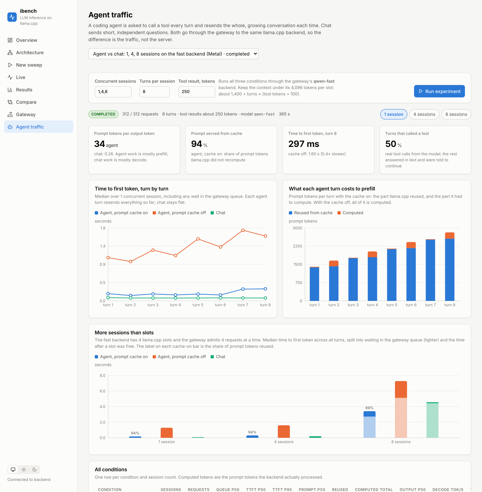
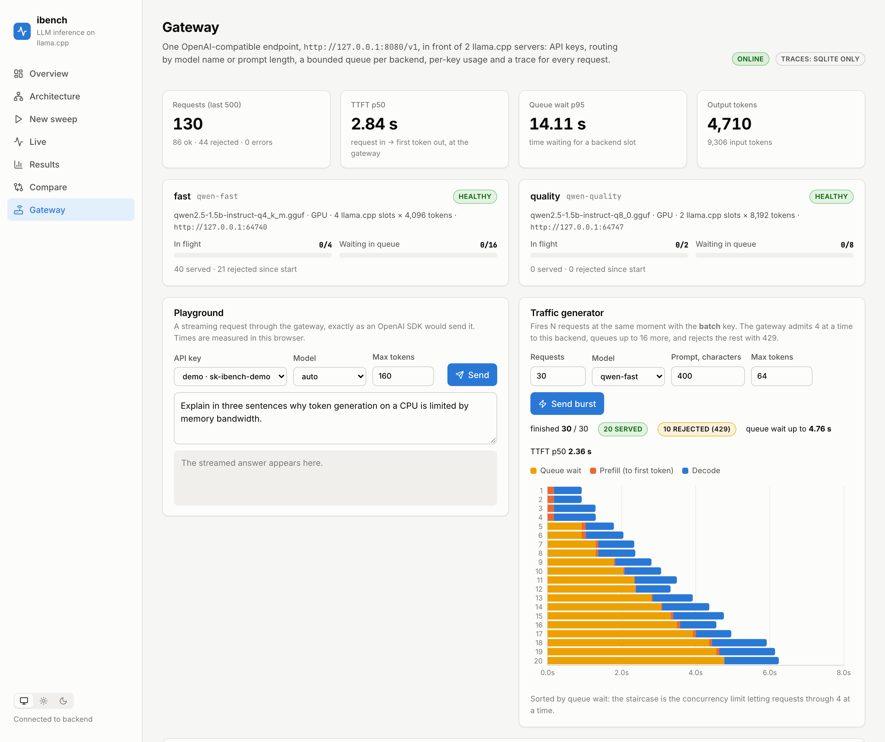

# inference_tools

Benchmarks and serving tools for small open LLMs on [llama.cpp](https://github.com/ggml-org/llama.cpp), with a React dashboard.

- **`ibench run`** sweeps a model across quantization, threads, prompt length and concurrency, and records time to first token, tokens per second and peak memory to CSV.
- **`ibench gateway`** is an OpenAI-compatible endpoint in front of two llama.cpp servers, with API keys, routing, a bounded queue per backend, per-key usage and OpenTelemetry traces.
- **`ibench agent`** sends agent-style traffic (a multi-turn tool-calling loop with a growing context) and chat traffic through the gateway, with llama.cpp's prompt cache on and off.
- **`ibench serve`** opens the dashboard for running sweeps, watching them live, comparing results and driving the gateway.

Model used so far: Qwen2.5-1.5B-Instruct in Q4_K_M and Q8_0.

## Screenshots

All screenshots are from real runs on an Apple M5 MacBook Air (16 GB).

**Overview:** headline numbers from the latest sweep, the machine and the models.



**Results:** time to first token, per-request and total throughput, and memory as concurrency rises. The banner flags a sweep whose end-of-run control measurement drifted.



**Platform map:** an LLM serving platform in four layers, with how far this repo builds each component and the numbered path one chat request takes through them.



**Request lifecycle:** where the time goes for 8 concurrent requests: waiting, prompt processing and decoding, per request.



**Inside the worker:** llama.cpp slots and their KV cache, and a memory budget predicted from the GGUF header compared with the measured peak.



**Agent traffic:** a tool-calling agent resends its growing conversation every turn; chat sends short, independent questions. Time to first token by turn with the prompt cache on and off, what each turn costs to prefill, and what happens with more sessions than llama.cpp slots.



**Gateway:** backend status, a streaming playground, and a 30-request burst: 4 run at a time, 16 wait, and the rest get 429.



## Quick start

You need Python 3.11+, Node 18+ and llama.cpp (`brew install llama.cpp`).

```bash
mkdir -p models
for q in q4_k_m q8_0; do
  curl -L -o models/qwen2.5-1.5b-instruct-$q.gguf \
    https://huggingface.co/Qwen/Qwen2.5-1.5B-Instruct-GGUF/resolve/main/qwen2.5-1.5b-instruct-$q.gguf
done
uv venv && uv pip install -e '.[tracing]'
(cd web && npm install && npm run build)
```

```bash
.venv/bin/ibench run --preset smoke     # a quick sweep, written to results/
.venv/bin/ibench serve                  # dashboard on http://127.0.0.1:8000
.venv/bin/ibench gateway                # OpenAI-compatible API on http://127.0.0.1:8080/v1
```

Or run the gateway, both model servers and Jaeger with `docker compose up --build`.

## More

- [docs/GUIDE.md](docs/GUIDE.md): metrics, CLI options, the dashboard, the gateway, validation against `llama-bench`
- [BUILD_LOG.md](BUILD_LOG.md): what was built, what went wrong, what changed
- [PLAN.md](PLAN.md): the project plan

## License

MIT
